# AI Detective Room 🔍 🕵️‍♂️

[](https://react.dev/)
[](https://threejs.org/)
[](https://docs.pmnd.rs/react-three-fiber/)
[](https://nodejs.org/)
[](https://expressjs.com/)
[](https://www.mongodb.com/)
[](https://aistudio.google.com/)
[](https://vitejs.dev/)
[](https://tailwindcss.com/)

> An immersive, cinematic 3D mystery investigation game in the browser. Explore a physical crime scene, inspect forensic evidence, connect deductions on an investigation corkboard, and reason with an evidence-grounded Google Gemini AI detective mentor.

---

## 🏛️ System Architecture

The following diagram illustrates the complete end-to-end architecture across the **Presentation (3D & UI)** layer, the **Backend Application & Security** layer, and the **Cloud & AI Data** services.

```mermaid
flowchart TD
    subgraph Client["Frontend Client (Vercel / Vite SPA)"]
        subgraph WebGL["3D Game Engine (React Three Fiber + Three.js)"]
            Canvas3D["Canvas Scene & Camera Controls"]
            Room["3D Detective Office (Meshes & PBR Materials)"]
            Lights["Atmospheric Lighting (Amber Lamps, Spotlights, Ambient Noir)"]
            Props["Interactive 3D Props (Desk, Terminal, Corkboard, Cabinet, Lab Table)"]
            Canvas3D --> Room
            Canvas3D --> Lights
            Canvas3D --> Props
        end

        subgraph HUD["2D Overlay & HUD (React + Tailwind CSS + Framer)"]
            Dock["Evidence Inventory Dock & Station Switcher"]
            ModalInsp["Evidence Inspection Modal (Transcripts & Zoom)"]
            ModalBoard["Investigation Corkboard & Deduction Yarn"]
            ModalJournal["Detective Field Journal & Suspect Dossiers"]
            ModalVerdict["Verdict & Indictment Station"]
            ModalAI["Gemini AI Mentor Chat Drawer"]
        end

        Props -.->|"Click / Hover"| ModalInsp
        Dock -->|"Inspect"| ModalInsp
        Dock -->|"Open"| ModalBoard
        Dock -->|"Open"| ModalJournal
        Dock -->|"Submit"| ModalVerdict
        Dock -->|"Ask"| ModalAI
    end

    subgraph Server["Backend API (Render / Node.js + Express)"]
        Router["Express API Router (/api/v1)"]
        AuthMiddleware["JWT Cookie Auth & Session Guard"]
        
        subgraph Controllers["API Controllers"]
            CaseCtrl["Case Controller (Public Dockets & Clues)"]
            InvCtrl["Investigation Controller (Checkpoints & Progress)"]
            ScoreEngine["Authoritative Verdict Scoring Engine"]
            GeminiSvc["Grounded Gemini AI Service"]
        end

        Router --> AuthMiddleware
        AuthMiddleware --> CaseCtrl
        AuthMiddleware --> InvCtrl
        AuthMiddleware --> ScoreEngine
        AuthMiddleware --> GeminiSvc
    end

    subgraph CloudServices["External Cloud & AI Infrastructure"]
        subgraph MongoAtlas["MongoDB Atlas Cluster"]
            DB_Users[("Users Collection")]
            DB_Cases[("Cases Collection (Protected Canonical Solution)")]
            DB_Evidence[("Evidence Collection")]
            DB_Suspects[("Suspects Collection")]
            DB_Invs[("Investigations & Progress Collection")]
        end

        subgraph GeminiCloud["Google AI Studio"]
            GeminiAPI["Gemini 1.5 Pro API (Evidence-Grounded System Prompt)"]
        end
    end

    %% Network Connections
    HUD -->|"REST /api/v1 (VITE_API_URL)"| Router
    CaseCtrl <-->|"Mongoose Queries"| DB_Cases
    CaseCtrl <-->|"Read Clues"| DB_Evidence
    CaseCtrl <-->|"Read Suspects"| DB_Suspects
    InvCtrl <-->|"Read / Write State"| DB_Invs
    ScoreEngine <-->|"Authoritative Key (Server-Only)"| DB_Cases
    GeminiSvc <-->|"Grounded Prompt & Verification"| GeminiAPI
```



---

## 🔄 Core Gameplay & Investigation Loop

```mermaid
sequenceDiagram
    autonumber
    actor Detective as Player / Detective
    participant GameRoom as 3D Detective Scene
    participant API as Express Backend
    participant Gemini as Google Gemini AI
    participant DB as MongoDB Atlas

    Detective->>GameRoom: Enter 3D Room (Select Case #001)
    GameRoom->>API: GET /api/v1/cases/001
    API->>DB: Fetch case details & interactive prop map
    DB-->>API: Case metadata (Canonical solution redacted)
    API-->>GameRoom: Render room, lighting & clues

    rect rgb(20, 25, 35)
        Note over Detective,GameRoom: Exploration & Forensic Discovery
        Detective->>GameRoom: Click on Desk / Security Terminal / Cabinet
        GameRoom->>API: POST /api/v1/investigations/:id/evidence/:code
        API->>DB: Save discovered evidence to inventory
        API-->>GameRoom: Evidence recorded (E-01 .. E-06 unlocked)
        GameRoom-->>Detective: Open Inspection Modal & transcript
    end

    rect rgb(30, 25, 20)
        Note over Detective,Gemini: AI Detective Mentor Deduction
        Detective->>GameRoom: Ask Gemini: "Could the curator have committed the theft?"
        GameRoom->>API: POST /api/v1/investigations/:id/chat
        API->>Gemini: Prompt with strict grounding rules & case clues
        Note over Gemini: Evaluates alibi vs janitor statement (E-03 limp)<br/>Never reveals canonical culprit directly!
        Gemini-->>API: Return evidence-grounded response with citations
        API-->>GameRoom: Display mentor guidance + [E-02, E-03, E-05]
    end

    rect rgb(25, 30, 20)
        Note over Detective,API: Authoritative Verdict & Scoring
        Detective->>GameRoom: Open Indictment Station (Select Suspect + Evidence + Theory)
        GameRoom->>API: POST /api/v1/investigations/:id/verdict
        Note over API: Server evaluates:<br/>1. Culprit match (40 pts)<br/>2. Key evidence match (30 pts)<br/>3. Reasoning keywords (30 pts)<br/>4. Hint penalty deduction
        API->>DB: Mark investigation as Solved/Failed with official score
        API-->>GameRoom: Return Score breakdown, summary & case reconstruction
        GameRoom-->>Detective: Render cinematic Case Solved result screen
    end
```



---

## ✨ Key Features

| Feature | Description |
|---|---|
| **Real-time 3D Scene** | Fully explorable 3D detective office with realistic PBR materials, custom props (mahogany desk, CRT security terminal, steel filing cabinet, forensic lab table, typewriter indictment desk), and cinematic noir lighting. |
| **Camera Stations** | Smooth camera lerping between investigation stations (`Room Overview`, `Desk`, `Corkboard`, `Terminal`, `Cabinet`, `Verdict`) with mouse orbit controls. |
| **Grounded Gemini AI** | Google Gemini 1.5 Pro acts as an evidence-grounded senior detective mentor. Enforces strict anti-spoiler rules, cites discoverable evidence codes (`E-01` to `E-06`), and supports 3-tier progressive hints. |
| **Deduction Corkboard** | Interactive board where discovered clues and suspect photos can be pinned with simulated red yarn string connections. |
| **Detective Field Journal** | Tabbed notebook organizing Case Objectives, Suspect Dossiers (alibis, statements, motives), and personal detective notes. |
| **Authoritative Server Scoring** | Anti-cheat architectural protection: the canonical culprit and solution are strictly stored on the server (`select: false`) and evaluated mathematically across culprit accuracy, evidence selection, and reasoning depth. |
| **Dual Storage Fallback** | Seamless connection to MongoDB Atlas with an automatic in-memory fallback for offline or air-gapped development. |

---

## 📁 Project Directory Layout

```text
ai-detective-room/
├── package.json                 # Monorepo root scripts (dev, test, start)
├── DEPLOY.md                    # Complete deployment guide (Vercel + Render + GitHub)
├── spec.md                      # Single Source of Truth master specification
├── .env.example                 # Sanitized environment variable template
├── docs/                        # Specifications and design documentation
│   ├── SPEC.md                  # Detailed product specification
│   ├── API.md                   # Complete REST API reference
│   ├── GAME_DESIGN.md           # 3D art, camera, and lighting design
│   └── DEVELOPMENT.md           # Developer onboarding and setup guide
├── client/                      # Frontend Application (Vite + React 18)
│   ├── package.json             # Frontend dependencies (@react-three/fiber, three, tailwind)
│   ├── vite.config.js           # Vite build & proxy configuration
│   ├── vercel.json              # Vercel SPA rewrite rules
│   └── src/
│       ├── pages/               # LandingPage, CaseSelectPage, GameRoomPage
│       ├── game/
│       │   ├── scenes/          # 3D canvas scene orchestrator
│       │   ├── objects/         # 3D furniture meshes (Desk, Terminal, Board, etc.)
│       │   ├── lighting/        # Directional, point, and ambient lighting setup
│       │   └── controls/        # Camera presets & OrbitControls
│       ├── features/
│       │   ├── assistant/       # Grounded Gemini chat modal & progressive hints
│       │   ├── evidence/        # Evidence inspection modal & forensic views
│       │   ├── investigation/   # Interactive corkboard & string web
│       │   ├── timeline/        # Detective journal & suspect profiles
│       │   └── verdict/         # Indictment form & results score screen
│       └── services/            # API client service with offline fallback
└── server/                      # Backend API (Node.js + Express + Mongoose)
    ├── package.json             # Backend dependencies (@google/generative-ai, mongoose, etc.)
    └── src/
        ├── app.js               # Express app configuration & dynamic CORS
        ├── index.js             # Server entry point
        ├── config/db.js         # MongoDB connection with resilient timeout
        ├── models/              # Mongoose schemas (User, Case, Evidence, Suspect, Investigation)
        ├── controllers/         # Auth, Case, and Investigation logic
        ├── routes/              # Express API v1 routing endpoints
        ├── services/
        │   ├── gemini/          # Google Gemini 1.5 Pro prompt engineering & client
        │   └── game/            # Demo Case #001 data & server answer key
        └── test/                # Comprehensive Vitest & Supertest API verification
```

---

## 🛠️ Technology Stack Breakdown

| Domain | Technology | Purpose |
|---|---|---|
| **Frontend Framework** | React 18 + Vite 6 | Fast SPA rendering, component modularity, and rapid HMR |
| **3D Rendering** | Three.js (r173) | Core WebGL rendering engine |
| **React 3D Bridge** | React Three Fiber (v8) | Declarative Three.js scene graph management in React |
| **3D Helpers** | @react-three/drei (v9) | OrbitControls, HTML overlays, lighting helpers, and geometries |
| **Styling & UI** | Tailwind CSS + Lucide Icons | Responsive noir dark mode design and high-contrast typography |
| **Backend Framework** | Node.js (v20+) + Express.js | REST API, CORS management, and cookie authentication |
| **Database** | MongoDB Atlas + Mongoose (v8) | Persistent user records, saved investigations, and case clues |
| **AI Mentoring** | Google Gemini 1.5 Pro | Logical deduction, witness interrogation analysis, and hint generation |
| **Testing** | Vitest + Supertest + Testing Library | Automated unit, integration, and E2E API tests |

---

## 🚀 Getting Started

### 1. Prerequisites
- **Node.js**: `>= 20.0.0`
- **npm**: `>= 9.0.0`
- **MongoDB**: Local MongoDB or free [MongoDB Atlas](https://cloud.mongodb.com/) cluster
- **Google Gemini API Key**: Free from [Google AI Studio](https://aistudio.google.com/)

### 2. Environment Setup
Copy the environment template files:

```bash
# In project root
cp .env.example .env
cp .env.example server/.env
cp client/.env.example client/.env
```

Configure your credentials in `server/.env`:
```env
PORT=5001
MONGODB_URI=mongodb+srv://<username>:<password>@cluster0.xxx.mongodb.net/ai_detective_room?retryWrites=true&w=majority
JWT_SECRET=super_secret_detective_jwt_key
GEMINI_API_KEY=your_gemini_api_key_here
GEMINI_MODEL=gemini-1.5-pro
CLIENT_URL=http://localhost:5173
```

### 3. Install Dependencies
```bash
# Install root, server, and client dependencies
npm install
npm install --prefix server
npm install --prefix client
```

### 4. Run Development Servers
Launch both backend and frontend concurrently:
```bash
npm run dev
```

- **Frontend Application**: `http://localhost:5173`
- **Backend API**: `http://localhost:5001`
- **API Health Check**: `http://localhost:5001/api/v1/health`

### 5. Run Test Suites
```bash
# Run all server and client tests
npm test
```

---

## 🚢 Deployment Guide

The project is pre-configured for production deployment:
- **Frontend**: [Vercel](https://vercel.com) (Configured with [`client/vercel.json`](client/vercel.json))
- **Backend**: [Render](https://render.com) (Configured with dynamic CORS & Node.js web service)
- **Database**: [MongoDB Atlas](https://cloud.mongodb.com)

👉 **For step-by-step instructions with screenshots and troubleshooting, see [DEPLOY.md](DEPLOY.md).**

---

## 🔎 Initial Demo Case Docket

### **Case #001: The Missing Diamond**
- **Difficulty**: Medium
- **Location**: Museum Exhibition Hall at Night
- **Objective**: Establish who bypassed the laser vitrine grid and stole the Royal Sapphire Diamond during the midnight guard rotation.
- **Suspects**:
  1. *Marcus Finch* — Head Security Guard (volunteered for solo night shift, right ankle limp).
  2. *Dr. Elena Vance* — Chief Curator (badge scanned at 23:42, stiff locker cylinder reported).
  3. *Julian Sterling* — Visiting Antiquities Collector (hotel alibi, private acquisition offer).
- **Available Clues**:
  - `E-01`: High-resolution photograph of empty vitrine with override marks.
  - `E-02`: Door electronic access badge scanner logs.
  - `E-03`: Night custodian witness interview transcript (figure with distinct limp).
  - `E-04`: Vitrine optical sensor diagnostic report (bypass PIN `8821`).
  - `E-05`: Employee health report & sprained ankle medical record.
  - `E-06`: Facility maintenance ticket for locker #14 master key access.

---

## 📄 License & Attribution

This project is licensed under the MIT License. Developed following the **AI Detective Room Master Specification v2.0.0**.
